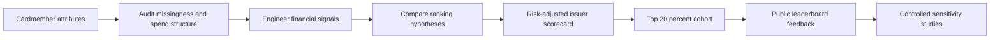

# Credit-Card Profitability Analytics — American Express Campus Challenge 2026

**Financial analytics | 500,000 records | interpretable risk-adjusted scorecard | feature engineering | exploratory segmentation | ranking experiments**

> Independent educational portfolio reconstruction of a 2026 campus challenge. Not affiliated with American Express. The released dataset has no actual profitability labels. Competition data, private submissions and leaderboard screenshots are not distributed here.

## Executive overview

**Business question:** Which premium cardmembers should an issuer prioritize if it wants to maximize *net* economics—not merely transaction volume? A cardmember can spend heavily yet produce limited issuer value after financing risk, collections, rewards and premium-card benefits are considered.

**Task:** rank 500,000 anonymized customers from 23 masked financial and behavioral attributes and identify a top-20% cohort (100,000 accounts). The competition evaluated agreement with a *hidden* profitable top-20% cohort; the public leaderboard used 70% of the records and a private holdout used 30%.

**Best recorded public leaderboard result: 0.91 accuracy** (participant-reported). An interpretable profitability equation generated the predictions in the archived `2026_File5_Comeback26.xlsx` workbook **exactly** (500,000/500,000 rows reproduced). A conversation recorded a **0.910 public leaderboard score** for that file. This is a participant-reported result, **not independently authenticated**, not accuracy on a local labeled test set, and not a confirmed private leaderboard result.

**Why this is more than random coefficient tuning:** the analytical workflow examined credit-card economics, the dataset's structural missingness, financial interaction features, revenue vs. cost decomposition, exploratory unsupervised models, multiple ranking approaches, and submission sensitivity. Those components had different evidence levels: some were executed historically, while the clean, reproducible EDA/notebook/code below were added during the later portfolio reconstruction. **We distinguish them throughout.**

## Research snapshots — synthetic demo

The figures below are generated from **invented records**, not organizer-provided or real Amex customer data. They show what the EDA and segmentation pipeline produces when anyone runs it.

| Missingness audit | PCA / KMeans exploration |
|---|---|
|  |  |

The output on the original challenge dataset is kept private. The research notebook runs against the public synthetic example by default.

## End-to-end research story



| Stage | Analytical content | Evidence and reproducibility |
|---|---|---|
| Credit-card economics | Interchange-like revenue; revolving interest; expected credit loss; rewards, benefits, collections, retention | Research topics and source leads documented in historic conversations; coefficients are assumptions, **not actual Amex financial rates**. See `docs/LITERATURE_AND_FINANCIAL_LOGIC.md`. |
| Data understanding | Missingness, zeros, negative values, spend reconciliation, feature collinearity and correlations | Ran earlier in the project; locally reproducible via `src/research.py`. |
| Feature engineering | Risk × revolving balance, risk × lending line, benefit/spend, revolver/spend, spend residual, missingness indicators, signed-log transforms | Interaction terms used in the selected equation; additional exploratory transforms in `src/feature_engineering.py`. See provenance notes. |
| Alternative approaches | Revenue-score versions, PCA/KMeans/hierarchical clustering, mutual information to PCA component, 10–11 financial hypothesis rankers, rank/percentile blends | Earlier conversations and code demonstrate these *lines of analysis*; code for every early iteration is **not** available. Offline ablations can be run using current code. |
| Model selection | P&L-like relative index; exactly 100k top-ranked members | `src/profitability.py` + `src/score_customers.py`; reconstructed equation matches archived File5 predictions exactly. |
| Stability tests | Spend-only vs revenue-only vs risk-adjusted vs full P&L; benefit/reward coefficient sensitivity | `src/research.py`. Cohort overlap is **not ground-truth prediction accuracy**. |

## Key financial hypotheses

1. **Spend ≠ profit:** spending generates potential interchange-like revenue but does not reveal financing losses or reward costs.
2. **Risk depends on exposure:** a risk-score term interacts with revolving balances and lending-line amounts, rather than acting as a purely independent customer penalty. This is a **proxy**, not a calibrated expected-credit-loss model.
3. **Benefits have two sides:** lounge access, airline/cab credits and redeemed points are modeled as costs; they may also correlate with retention and engagement. We probed penalty sensitivity instead of assuming use is intrinsically unprofitable.
4. **Missingness can carry information:** lending-line and reward fields have many blanks. Treating blanks as zero was the selected candidate's computational rule; it is not proof that a blank always means zero exposure or that a customer holds a charge card.
5. **Revenue and risk interact:** the reference equation includes both direct amounts and multiplicative cross-terms, making it more expressive than a spend-only ranking.

### Reference scorecard

```text
Relative issuer-profitability index
  = estimated spend-category + total-spend contribution
  + revolving-balance contribution
  - risk × (revolving balance + category spend / 12)
  - risk × lending-line provision
  - collection and cancellation cost proxies
  - lounge, airline, cab and redemption cost proxies
  + supplementary-account and login contributions
```

This candidate uses **17 of the 23 input features**. Coefficients are documented in `src/profitability.py`. They are empirically calibrated *hypotheses*, not causal effects or audited issuer P&L quantities. For example, a negative lodging-spend term reflects an empirical ranking assumption; it is **not a claim** that lodging is inherently unprofitable.

## Key findings and limitations

- The dataset contains unusual missing-data structure, so naive blanket imputation can change financial interpretation; the reference score nevertheless uses zero for many fields, and median imputation for risk when absent.
- Some amount-like features include negatives; signed-log transforms are safer than applying plain `log1p` indiscriminately.
- Lending-line features can encode overlapping information and were examined for double-counting.
- PCA/KMeans are **exploratory segmentation tools**, not proof that the clusters represent the issuer's hidden profitability classes.
- The final cohort is selected by *rank*, not by a calibrated probability threshold; the file marks exactly 100,000 of 500,000 records positive.
- Multiple workbook versions were audited. The reference File5's predictions were perfectly reproduced, but the final submitted filename and private leaderboard score remain unverified.

See `docs/EDA_AND_FEATURES.md`, `docs/EXPERIMENT_HISTORY.md`, and `docs/EVIDENCE_AND_LIMITATIONS.md` for the historical vs. newly executed distinction.

## Reproduce the project

Python 3.10+:

```bash
python -m pip install -r requirements.txt
python -m unittest discover -s tests -v

# All screenshots are derived from this reproducible synthetic example:
python scripts/make_synthetic_demo.py

# Public demo uses only synthetic records:
python -m src.score_customers --data sample_data/synthetic_cardmembers.csv --output outputs/synthetic_predictions.csv
python -m src.research --data sample_data/synthetic_cardmembers.csv --out outputs/synthetic_research

# Optional: run locally on the original, only if authorized.
# The CSV must contain id and f1..f23. Do NOT commit this source file.
python -m src.score_customers --data data/raw/challenge_data.csv --output outputs/predictions.csv
python -m src.research --data data/raw/challenge_data.csv --out outputs/research --clusters
```

To compare multiple candidate Excel workbooks locally *without publicizing IDs or binary predictions*, use:

```bash
python -m src.audit_submissions --glob 'private_submissions/*.xlsx' --reference '2026_File5_Comeback26.xlsx' --out outputs/submission_comparison.csv
```

**What comparison means:** A model's overlap with the selected scorecard tells us how much a *cohort changed*, not which cohort is truly more profitable. Actual leaderboard evaluation requires the organizer's hidden target labels.

## Contents

```text
src/
  profitability.py          historical 0.910 candidate equation
  score_customers.py        rank exactly top 20%, preserve row order
  feature_engineering.py    exploratory financial interaction features
  research.py               EDA, cohort ablations, sensitivity, PCA/KMeans
  audit_submissions.py      compare local Excel prediction sets (aggregate output only)
notebooks/
  research_walkthrough.ipynb  synthetic default, optional authorized data
sample_data/
  synthetic_cardmembers.csv
config/
  feature_dictionary.csv
  leaderboard_evidence.csv
reports/
  README.md                  what stays private
tests/                      automated checks

docs/
  LITERATURE_AND_FINANCIAL_LOGIC.md
  EDA_AND_FEATURES.md
  EXPERIMENT_HISTORY.md
  EVIDENCE_AND_LIMITATIONS.md
  METHODOLOGY.md
  RESEARCH_DESIGN.md
  IMPLEMENTATION_MAP.md
  RESUME_AND_INTERVIEW.md
  PUBLISH_TO_GITHUB.md
```

## Interview-ready project summary

> **Premier Cardmember Profitability Analytics | American Express Campus Challenge 2026** — Developed an interpretable credit-card profitability scorecard for 500K anonymized records, using spending, revolving balances, risk-exposure interactions and rewards/benefit costs. Conducted feature analysis, alternative ranking experiments and exploratory customer segmentation. Recorded a participant-reported **0.91 public leaderboard accuracy** when selecting the top 20% of cardmembers.

For the verified statement, experiment breakdown and interview answers, see [`docs/RESUME_AND_INTERVIEW.md`](docs/RESUME_AND_INTERVIEW.md) and [`docs/IMPLEMENTATION_MAP.md`](docs/IMPLEMENTATION_MAP.md).

## Publishing to GitHub

See [`docs/PUBLISH_TO_GITHUB.md`](docs/PUBLISH_TO_GITHUB.md). Extract the ZIP and publish the **folder contents**; do not upload a single ZIP into a GitHub repository.

## Disclosure and publishing

**Keep private:** 500k challenge dataset, all XLSX submission workbooks, individual cardmember predictions, private chat transcripts, screenshots/account information, and any challenge materials whose redistribution is not permitted. `.gitignore` excludes `data/raw/`, `private_submissions/`, `outputs/` and other local artifacts. Notebook plots generated using the private dataset should only be published after permission review. Do not use this scorecard for real credit decisions: the coefficients are unvalidated, customer attributes are masked, actual outcomes are unavailable, and fairness/model-risk checks have not been performed.
